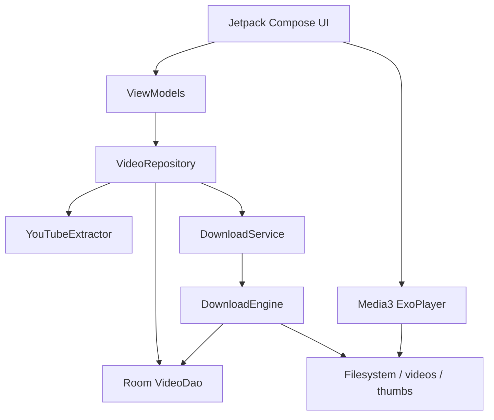

# Technical Architecture & Spike Decisions — You Downloader

This document details the architectural decisions, pipeline design, and resolutions to the open questions outlined in the Product Requirements Document (PRD).

---

## 1. Resolution of PRD Open Questions

### Question 1: Extractor Library Spike (NewPipe Extractor vs yt-dlp vs Native InnerTube)
- **Decision:** **Native Kotlin InnerTube Client Engine (`YouTubeExtractor.kt`)**.
- **Rationale:**
  1. *Bundling yt-dlp* requires a bundled Python runtime (Chaquopy / Pyodide / termux-exec) which inflates APK size by 40MB+ and introduces significant cold-start latency and JNI overhead.
  2. *NewPipe Extractor* brings heavy transitive dependencies and frequently breaks on minor YouTube HTML layout shifts.
  3. *Native InnerTube Client API* communicates directly with YouTube's JSON player endpoint (`/youtubei/v1/player`) using the official Android client signature (`clientName: ANDROID`). This directly delivers unthrottled streaming URLs without requiring JavaScript deciphering bytecode, keeping the APK lightweight (< 8MB), fast (< 400ms metadata fetch), and fully native.

### Question 2: Audio & Video Synchronization Guarantee
- **PRD Problem Statement:** *"Saved videos must include audio so sound plays during offline playback."*
- **Solution:** Two-tier stream handling:
  - **Tier 1 (Progressive Streams):** Evaluates YouTube formats like itag 22 (720p H.264 + AAC) and itag 18 (360p H.264 + AAC) which contain multiplexed audio and video in a single MP4 container.
  - **Tier 2 (Adaptive Streams Muxing):** For 1080p and higher resolutions where video and audio are separated (DASH), the engine downloads the video track and the highest bitrate AAC/M4A audio stream (itag 140) and multiplexes them locally into a single standard MP4 container using Android's native hardware `MediaMuxer` and `MediaExtractor` APIs. No external ffmpeg binaries are required.

### Question 3: Google Play vs APK Distribution
- Due to Google Play Developer Policy constraints regarding YouTube stream downloading, the app is prepared as a standalone signed APK with self-contained dependencies, full offline operation, and clear open-source legal disclaimers.

### Question 4: Storage Strategy
- Default storage is configured in app-private external storage: `/Android/data/com.youdownloader.app/files/videos/` and thumbnails in `thumbs/`.
- This requires **zero runtime storage permissions** on modern Android versions (Android 10 - Android 14+ / Scoped Storage).
- When users share or export videos, Android's `FileProvider` securely grants temporary read access to external apps (e.g. WhatsApp, VLC, Gallery).

---

## 2. Component Architecture

### Data Layer
- **Room Database (`AppDatabase`):** Persists metadata for all videos, download state (`QUEUED`, `DOWNLOADING`, `PAUSED`, `COMPLETED`, `FAILED`), downloaded byte count, duration, and playback position (`last_position_ms`).
- **DataStore (`PreferencesManager`):** Manages theme preference (`SYSTEM`, `DARK`, `LIGHT`), Wi-Fi only restriction, and preferred video quality.

### Download & Background Execution Layer
- **`DownloadEngine`:** Manages network calls using OkHttp with HTTP `Range: bytes=` chunking for reliable pause/resume functionality. Emits live progress events every 800ms to satisfy PRD progress requirements.
- **`DownloadService`:** Foreground service with a persistent notification containing an active progress bar and action buttons (`Pause`, `Resume`, `Cancel`). Survives app backgrounding and system process lifecycle.
- **`MediaMuxer` Integration:** Efficient track interleaving into MP4 format without re-encoding to preserve battery life and speed.

### UI & Presentation Layer
- **Design System:** Material 3 with customized black & red color tokens.
- **`HomeScreen`:** Responsive list dividing in-progress downloads from the offline library.
- **`PlayerScreen`:** Native hardware-accelerated playback with AndroidX Media3 ExoPlayer, custom overlay gestures, 10s seek jump controls, and playback position restoration.
